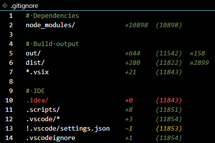

# IgnoreLens

A VS Code extension that shows how many files each ignore line matches and highlights lines with no matches. No matches could mean a typo is exposing your files.

It tracks a running count of ignored files (the number in brackets). Exclusions can add files, and exceptions can remove them.



## Usage

IgnoreLens activates automatically for its 47 supported file types. The majority of these follow the .gitignore syntax.

To use with any file, change its language mode to `ignore` via the status bar or command palette (Ctrl+Shift+P → "Change Language Mode"). 

## Match Counts

IgnoreLens decorates each line depending upon how it affects the running count of workspace files.

| Symbol | Meaning |
|--------|---------|
| `+N` | Files added to running count |
| `−N` | Files removed from running count |
| `(N)` | Running count total |
| `≡N` | Already counted (shadowed by earlier line) |
| `∅N` | Files matched by a negation but not present in the running count |
| `✗N` | Blocked by parent directory |
| `⚠` | Pattern or workspace scan warning. Hover for details. |

Counts are colour-coded:
- **Green**: Line is adding files
- **Yellow**: Negation line, or shadowed line (files already ignored by earlier line)
- **Red**: Line matches nothing

### Real-time Updates

Decorations update automatically when you edit the file or when workspace files change.
Workspace file lists are cached and updated as files are created or deleted, which avoids repeated full scans.

## Supported Files

IgnoreLens supports **47 ignore file formats**:

### Gitignore-Compliant Formats (31)

Standard gitignore rules apply:
- `*` matches anything except `/`, `**` matches any path including `/`, `?` matches single character
- `*.ext` matches at any depth (basename matching)
- `dir/` directory pattern, blocks negations for files inside
- `!pattern` negation (un-ignore), `#` comment
- Trims trailing spaces only (tabs preserved)

| File | Tool/Platform | Docs |
|------|---------------|------|
| | **Version Control** | |
| `.gitignore` | Git | [gitignore](https://git-scm.com/docs/gitignore) |
| | **AI Coding Tools** | |
| `.aiderignore` | Aider | [aider](https://aider.chat/docs/faq.html) |
| `.aiexclude` | Gemini Code Assist | [aiexclude](https://docs.cloud.google.com/gemini/docs/codeassist/create-aiexclude-file) |
| `.aiignore` | JetBrains AI | [AI Assistant](https://www.jetbrains.com/help/ai-assistant/disable-ai-assistant.html) |
| `.augmentignore` | Augment Code | [augmentcode](https://www.augmentcode.com/) |
| `.clineignore` | Cline | [cline](https://github.com/cline/cline) |
| `.codeiumignore` | Windsurf/Codeium | [ignore files](https://docs.devin.ai/desktop/context-awareness/devin-ignore) |
| `.cursorignore` | Cursor | [cursor](https://cursor.com/) |
| `.geminiignore` | Gemini CLI | [gemini-ignore](https://geminicli.com/docs/cli/gemini-ignore/) |
| `.tabnineignore` | Tabnine | [tabnine](https://docs.tabnine.com/) |
| | **Build & Package** | |
| `.distignore` | WordPress CLI | [dist-archive](https://developer.wordpress.org/cli/commands/dist-archive/) |
| `.swagger-codegen-ignore` | Swagger Codegen | [swagger codegen](https://swagger.io/docs/open-source-tools/swagger-codegen/) |
| | **Cloud & Deployment** | |
| `.cfignore` | Cloud Foundry | [deploy guide](https://docs.cloudfoundry.org/devguide/deploy-apps/prepare-to-deploy.html) |
| `.ebignore` | AWS Elastic Beanstalk | [EB CLI config](https://docs.aws.amazon.com/elasticbeanstalk/latest/dg/eb-cli3-configuration.html) |
| `.terraformignore` | Terraform | [cloud settings](https://developer.hashicorp.com/terraform/cli/cloud/settings) |
| `.upignore` | Up (serverless) | [apex/up](https://github.com/apex/up) |
| `.vercelignore` | Vercel | [vercel ignore](https://vercel.com/docs/deployments/vercel-ignore) |
| | **Code Formatters** | |
| `.prettierignore` | Prettier | [ignoring code](https://prettier.io/docs/ignore) |
| | **Frameworks** | |
| `.eleventyignore` | Eleventy (SSG) | [ignores](https://www.11ty.dev/docs/ignores/) |
| `.nuxtignore` | Nuxt | [nuxtignore](https://nuxt.com/docs/guide/directory-structure/nuxtignore) |
| | **Linters** | |
| `.alexignore` | alex (writing linter) | [alex](https://github.com/get-alex/alex) |
| `.eslintignore` | ESLint | [ignore config](https://eslint.org/docs/v8.x/use/configure/ignore#the-eslintignore-file) |
| `.markdownlintignore` | markdownlint | [markdownlint](https://github.com/DavidAnson/markdownlint) |
| `.solhintignore` | Solhint (Solidity) | [solhint](https://protofire.github.io/solhint/) |
| `.stylelintignore` | Stylelint | [ignore code](https://stylelint.io/user-guide/ignore-code/) |
| `.stylintignore` | Stylint | [stylint](https://github.com/SimenB/stylint) |
| | **Misc.** | |
| `.flooignore` | Floobits | [floobits-sublime](https://github.com/Floobits/floobits-sublime) |
| `.ignore` | ripgrep/fd/etc | [ripgrep](https://github.com/BurntSushi/ripgrep) |
| `.jpmignore` | Mozilla Jetpack | [jpm](https://github.com/mozilla-jetpack/jpm) |
| `.rgignore` | ripgrep | [ripgrep](https://github.com/BurntSushi/ripgrep) |
| `.tokeignore` | Tokei (code stats) | [tokei](https://github.com/XAMPPRocky/tokei) |

### Other Supported Formats (16)

| File | Tool/Platform | Notes | Docs |
|------|---------------|-------|------|
| `.bazelignore` | Bazel (build system) | Literal paths to directories under the workspace root | [bazelrc](https://bazel.build/run/bazelrc) |
| `.bzrignore` | Bazaar (VCS) | `!` is literal | [bzr ignore](https://manpages.ubuntu.com/manpages/xenial/man1/bzr.1.html#bzr_ignore__NAME_PATTERN..._) |
| `.chefignore` | Chef (config mgmt) | `!` is literal | [chefignore](https://docs.chef.io/client/19/cookbooks/chef_repo/#chefignore) |
| `.cvsignore` | CVS (VCS) | Whitespace separates patterns. A lone `!` clears the list. `#` is literal. | [cvsignore](https://ftp.gnu.org/old-gnu/Manuals/cvs-1.9/html_chapter/cvs_21.html#SEC148) |
| `.deployignore` | DeployHQ | DeployHQ can restore a file inside an excluded directory. IgnoreLens keeps it excluded. | [DeployHQ pattern examples](https://www.deployhq.com/blog/excluding-files-with-deployignore) |
| `.dockerignore` | Docker | Leading `/` stripped | [build context](https://docs.docker.com/build/concepts/context/) |
| `.gcloudignore` | Google Cloud | Basenames match at any depth. `#!include:<file>` inserts rules from a regular file in the same directory. | [gcloudignore](https://docs.cloud.google.com/sdk/gcloud/reference/topic/gcloudignore) |
| `.helmignore` | Helm (Kubernetes) | A `!` rule excludes paths that fail the pattern. Helm rejects `**`. | [helm ignore](https://helm.sh/docs/chart_template_guide/helm_ignore_file/) |
| `.jshintignore` | JSHint | JSHint uses minimatch globs. IgnoreLens uses Git-style rules. | [JSHint CLI](https://jshint.com/docs/cli/#ignoring-files) |
| `.nodemonignore` | nodemon (legacy) | nodemon 3 dropped this file. IgnoreLens reads it using Git-style rules. | [nodemon FAQ](https://github.com/remy/nodemon/blob/main/faq.md#my-nodemonignore-is-being-ignored) |
| `.npmignore` | npm | Basenames match at any depth, ignoring case. Path exceptions can reopen directories. | [npm package files](https://docs.npmjs.com/cli/v11/configuring-npm/package-json/#files) |
| `.p4ignore` | Perforce (VCS) | A leading `/` or `\` anchors to the ignore file's directory. The last matching rule wins. | [P4IGNORE](https://help.perforce.com/helix-core/server-apps/cmdref/current/Content/CmdRef/P4IGNORE.html) |
| `.slugignore` | Heroku | IgnoreLens treats a leading `!` as an exception. Heroku's slug compiler has no exception syntax. | [Heroku slug compiler](https://devcenter.heroku.com/articles/slug-compiler#ignoring-files-with-slugignore) |
| `.tfignore` | Team Foundation (VCS) | `\` anchors to root, no dir blocking | [TFVC ignore](https://learn.microsoft.com/en-us/azure/devops/repos/tfvc/add-files-server) |
| `.vscodeignore` | VS Code Extension API | `*.ext` root only, trims all whitespace | [publishing extensions](https://code.visualstudio.com/api/working-with-extensions/publishing-extension) |
| `.yarnignore` | Yarn Classic | Yarn Classic ignores case when matching patterns. IgnoreLens uses case-sensitive matching for this file. | [Yarn Classic matcher](https://github.com/yarnpkg/yarn/blob/v1.22.22/src/util/filter.js#L107-L143) |

## Configuration

Access settings via File → Preferences → Settings (or `Ctrl+,`) and search for "ignorelens".

| Setting | Description | Default |
|---------|-------------|---------|
| `ignorelens.enabled` | Enable or disable decorations | `true` |
| `ignorelens.decorationStyle` | How to highlight redundant lines: `none`, `background`, `text`, or `both` | `text` |
| `ignorelens.showMatchCount` | Show match counts after each line | `true` |
| `ignorelens.scanDebounceMs` | Delay before rescanning after changes (ms) | `500` |
| `ignorelens.debug` | Enable debug logging to Output panel | `false` |

### Customising Colours

Add to your `settings.json`:

```jsonc
{
  "workbench.colorCustomizations": {
    "ignorelens.noMatchForeground": "#f14c4c",         // Red text for redundant lines
    "ignorelens.noMatchBackground": "#4a1a1a40",       // Red background for redundant lines
    "ignorelens.matchCountForeground": "#6A9955",      // Green text for matching lines
    "ignorelens.negationForeground": "#CCAA00",        // Yellow text for negation lines
    "ignorelens.staleMatchCountForeground": "#3d5c30", // Stale: darker green
    "ignorelens.staleNoMatchForeground": "#8b2020",    // Stale: darker red
    "ignorelens.staleNoMatchBackground": "#2a0a0a40",  // Stale: darker red background
    "ignorelens.staleNegationForeground": "#7a6600"    // Stale: darker yellow
  }
}
```

The `stale` colours are shown briefly when switching tabs while cached data refreshes.

## Limitations / Notes

- **Each file is analysed independently.** IgnoreLens doesn't consider how multiple ignore files interact. For example, ripgrep allows `.rgignore` to override `.gitignore` rules, but IgnoreLens shows each file's matches in isolation.

- **Empty folders.** IgnoreLens counts files, so a rule for an empty folder shows zero matches.

- **Hidden files are included in counts.** Files with the hidden attribute (Windows), hidden flag (macOS), or starting with `.` (Linux/Unix) are counted like regular files.

- **Symlinks.** If IgnoreLens detects a symlink loop in the workspace, it skips all symlink targets because a weakness in vscode.workspace.findFiles() can crash VS Code.

- **Odd Git logic.** Ignore Lens follows odd Git logic. For example with `core.ignoreCase=true`, `[D]ocs.md` matches zero of `docs.md`, `Docs.md`, and `DOCS.md`. Use `[d]ocs.md` to match all three.

## Technology Stack

- **Language:** TypeScript 6.0.3
- **Framework:** VS Code Extension API (1.85.0+)
- **Key Libraries:**
  - `ignore` (7.0.16) - Gitignore pattern matching
  - `minimatch` (10.2.6) - Glob pattern matching for vscodeignore

## Acknowledgements

Developed with assistance from:
- [Anthropic Claude](https://code.claude.com/docs/en/overview) (Opus 4.5- 4.8)
- [OpenAI Codex](https://openai.com/index/openai-codex/) (GPT-5.1 - 6.2)
- [Z.AI](https://z.ai/) (GLM 5.3)

Thanks to:
- [GitSparTV](https://github.com/GitSparTV) for identifying the running count tracking issue.
- [RedCMD](https://github.com/RedCMD) for identifying the [a].ts wildcard and trailing tab issues.

## Licence

MIT License - Copyright (c) 2025-2026 Jason Gordon

Free to use, modify, and distribute. See [LICENSE](LICENSE) for details.
